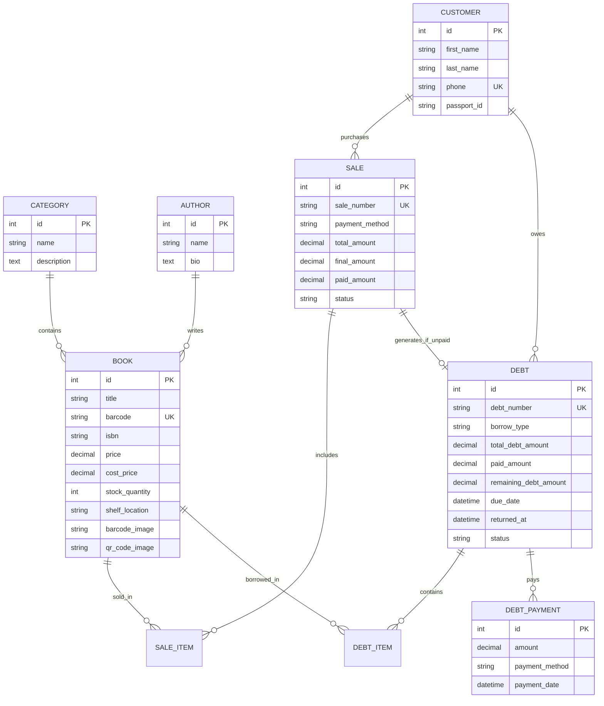

# 📚 Kitob Do'koni Boshqaruv Tizimi (Bookstore POS & Management API)

Zamonaviy kitob do'koni va kutubxonalar uchun mo'ljallangan **Django REST Framework (DRF)** asosidagi to'liq avtomatlashtirilgan backend tizimi va veb-paneli.

Ushbu tizim orqali kitoblarni **sotish (kitob olish)**, **nasiyaga / qarzga berish**, **shtrix-kod (barcode) va QR-kod orqali tezkor skaner qilish**, **qarzlar daftari hisob-kitobi** va **tahliliy hisobotlar** yuritiladi.

---

## 📑 Mundarija
1. [Loyiha Imkoniyatlari](#-loyiha-imkoniyatlari)
2. [Texnologiyalar Steki](#-texnologiyalar-steki)
3. [Ma'lumotlar Bazasi Arxitekturasi (ERD)](#-malumotlar-bazasi-arxitekturasi-erd)
4. [Skaner Tizimi Qanday Ishlaydi?](#-skaner-tizimi-qanday-ishlaydi)
5. [To'liq API Endpointlari](#-toliq-api-endpointlari)
6. [API So'rov va Javob Namunalari](#-api-sorov-va-javob-namunalari)
7. [Mahalliy Muhitda Ishga Tushirish (Local)](#-mahalliy-muhitda-ishga-tushirish-local)
8. [Railway.app Platformasiga Deploy Qilish (To'liq Qo'llanma)](#-railwayapp-platformasiga-deploy-qilish-toliq-qollanma)
9. [Testlar va Xavfsizlik](#-testlar-va-xavfsizlik)

---

## 🚀 Loyiha Imkoniyatlari

* 📦 **Kitoblar Ombori:** Har bir kitob qo'shilganda unga avtomatik ravishda **Code128 Shtrix-kod** va **JSON QR-kod** tasviri generatsiya qilinadi.
* 🔍 **Skaner Tizimi:** Skaner to'pponchasi, mobil kamera yoki qo'lda kiritilgan kod orqali kitobning narxi, ombordagi soni, polkadagi o'rni va **ushbu kitob hozirda kimlarda qarzda ekanligi** zudlik bilan chiqadi.
* 🛒 **Kitob Olish (Sotish / Savdo):** Naqd, karta, nasiya (qarz) yoki aralash to'lov turlari. Sotilganda ombordagi qoldiq avtomatik kamayadi.
* 📒 **Qarzlar Daftari (Nasiya va Ijara):**
  * `PURCHASE_DEBT` — Kitobni nasiyaga sotib olish (kitob mijozda qoladi, pulini to'laydi);
  * `RENT_BORROW` — Kitobni o'qishga / ijaraga olish (kitob qaytarilganda omborga qayta qo'shiladi).
* 💳 **Qarz To'lovlari Tarixi:** Qarzni qismlarga bo'lib to'lash. Qolgan summa 0 bo'lganda qarz avtomatik yopiladi (`PAID`).
* ⚠️ **Muddati O'tgan Qarzdorlar:** Qaytarish yoki to'lash muddati o'tib ketgan qarzdorlar ro'yxati va ularning umumiy qarzi hisoboti.
* 📊 **Dashboard va Statistika:** Jami kitoblar, omborning umumiy narxi, bugungi tushum, eng ko'p sotilgan kitoblar.
* 📑 **OpenAPI 3.0 (Swagger & Redoc):** Har bir API to'liq hujjatlashtirilgan.

---

## 🛠 Texnologiyalar Steki

| Qism | Texnologiya | Izoh |
| :--- | :--- | :--- |
| **Backend Framework** | Django 6.1.2 & Django REST Framework 3.18 | Asosiy API va biznes mantiq |
| **Ma'lumotlar Bazasi** | PostgreSQL (Railway) / SQLite3 (Local) | `dj-database-url` orqali avtomatik ulanish |
| **Statik & Media** | WhiteNoise 6.12 + Pillow 13.0 | Statik fayllar va rasmlar boshqaruvi |
| **Shtrix & QR Kod** | `python-barcode` + `qrcode` | Code128 va QR-kod tasvirlarini yaratish |
| **API Hujjatlari** | `drf-spectacular` | OpenAPI 3.0, Swagger UI va Redoc |
| **Production Server** | Gunicorn 26.2 | Railway platformasi uchun WSGI server |
| **Frontend Panel** | HTML5, Tailwind CSS, Lucide Icons, HTML5-QRCode | Kamera skaneri va boshqaruv oynasi |

---

## 🗄 Ma'lumotlar Bazasi Arxitekturasi (ERD)



---

## 🔍 Skaner Tizimi Qanday Ishlaydi?

1. **Kitob yaratilishi bilanoq:**
   - Dastur unga 12-xonali unikal shtrix-kod beradi va **Code128** formatidagi shtrix-kod tasvirini yaratadi (`/media/barcodes/`).
   - Shuningdek, kitob ma'lumotlari (`id`, `title`, `barcode`, `price`, `stock`, `shelf`) shifrlangan **QR-kod** tasvirini yaratadi (`/media/qrcodes/`).
2. **Skanerlash paytida:**
   - Skaner to'pponchasi yoki kamera o'qigan kod `GET /api/scan/?code=<kod>` yoki `POST /api/scan/` ga yuboriladi.
   - Tizim kodni aqlli tekshiradi: oddiy shtrix-kodmi, ISBN-mi, yoki QR-kod JSON obyektimi.
   - Kitob topilgach, uning narxi va ombordagi sonidan tashqari, **ushbu kitob ayni paytda kimlarda qarzda/nasiyada ekanligini** ham chiqarib beradi.

---

## 📡 To'liq API Endpointlari

### 1. Skanerlash (Scan)
* `GET /api/scan/?code=<barcode_yoki_qr>` — Shtrix-kod yoki QR-kod orqali kitob ma'lumotlarini olish.
* `POST /api/scan/` — Body orqali kod yuborib skaner qilish.

### 2. Kitoblar (Books)
* `GET /api/books/` — Kitoblar ro'yxati (filtrlash, qidirish, saralash).
* `POST /api/books/` — Yangi kitob qo'shish (shtrix va QR-kod avtomatik yaratiladi).
* `GET /api/books/{id}/` — Kitobning to'liq ma'lumotlari va uni qarzga olganlar ro'yxati.
* `PUT / PATCH /api/books/{id}/` — Kitobni yangilash.
* `DELETE /api/books/{id}/` — Kitobni o'chirish.
* `GET /api/books/low-stock/` — Omborda 5 tadan kam qolgan kitoblar ro'yxati.
* `POST /api/books/{id}/regenerate-codes/` — Shtrix-kod va QR-kodni qayta generatsiya qilish.

### 3. Kitob Olish va Sotish (Sales)
* `GET /api/sales/` — Barcha xaridlar va cheklar ro'yxati.
* `POST /api/sales/` — Yangi kitob sotish (ombordagi qoldiq kamayadi).
* `GET /api/sales/{id}/` — Xarid tafsilotlari va chek ma'lumotlari.

### 4. Qarzlar Daftari (Debts & Loans)
* `GET /api/debts/` — Barcha qarzlar ro'yxati.
* `POST /api/debts/` — Kitobni qarzga / nasiyaga berish (ombordan kamayadi).
* `GET /api/debts/{id}/` — Qarz hujjati detallari va to'lovlar tarixi.
* `POST /api/debts/{id}/pay/` — Qarz uchun to'lov qabul qilish (qisman yoki to'liq).
* `POST /api/debts/{id}/return-book/` — Ijaraga olingan kitobni qaytarish (omborga qo'shiladi).
* `GET /api/debts/overdue/` — Muddati o'tgan qarzdorlar ro'yxati.

### 5. Mijozlar (Customers)
* `GET /api/customers/` — Mijozlar ro'yxati va ularning umumiy qarzdorlik summasi.
* `POST /api/customers/` — Yangi mijoz kiritish.
* `GET /api/customers/{id}/debts/` — Tanlangan mijozning barcha qarzlari.
* `GET /api/customers/{id}/sales/` — Tanlangan mijozning barcha xaridlari.

### 6. Statistika va Hujjatlashtirish
* `GET /api/dashboard/stats/` — Do'kon umumiy moliyaviy va ombor statistikasi.
* `GET /api/docs/` — Swagger UI interaktiv hujjatlari.
* `GET /api/redoc/` — Redoc formati.

---

## 💡 API So'rov va Javob Namunalari

### 1. Shtrix-kodni Skaner Qilish
**So'rov:**
```http
GET /api/scan/?code=9780132350884 HTTP/1.1
Host: 127.0.0.1:8000
```

**Javob (200 OK):**
```json
{
  "found": true,
  "scanned_code": "9780132350884",
  "matched_by": "BARCODE",
  "book": {
    "id": 4,
    "title": "Clean Code (Toza Kod)",
    "author": { "id": 3, "name": "Robert C. Martin" },
    "category": { "id": 2, "name": "Dasturlash va IT" },
    "isbn": "978-013-235-088-4",
    "barcode": "9780132350884",
    "price": "110000.00",
    "stock_quantity": 6,
    "is_in_stock": true,
    "shelf_location": "IT-10",
    "barcode_image": "/media/barcodes/barcode_9780132350884.png",
    "qr_code_image": "/media/qrcodes/qr_9780132350884.png",
    "active_borrowers": [
      {
        "debt_number": "DBT-20261025-1042",
        "customer_name": "Sardorbek Umarov",
        "customer_phone": "+998971112233",
        "borrow_type": "Nasiyaga sotib olish",
        "quantity": 1,
        "due_date": "2026-11-09T17:25:14+05:00",
        "status": "PARTIAL",
        "is_overdue": false
      }
    ]
  },
  "stock_status": {
    "in_stock": true,
    "quantity": 6,
    "badge": "AVAILABLE",
    "message": "Omborda yetarli: 6 dona mavjud",
    "shelf_location": "IT-10"
  },
  "analytics": {
    "total_sold_count": 5,
    "total_sold_amount": "550000.00",
    "active_borrowed_count": 1
  }
}
```

---

### 2. Kitob Sotish (Kitob Olish)
**So'rov:**
```http
POST /api/sales/ HTTP/1.1
Content-Type: application/json

{
  "customer_id": 1,
  "payment_method": "CASH",
  "discount_amount": "5000.00",
  "paid_amount": "90000.00",
  "items": [
    {
      "book_id": 1,
      "quantity": 2
    }
  ]
}
```

**Javob (201 Created):**
```json
{
  "id": 12,
  "sale_number": "ORD-20261025-4819",
  "customer": {
    "id": 1,
    "full_name": "Jamshid Karimov",
    "phone": "+998901234567"
  },
  "payment_method": "CASH",
  "total_amount": "96000.00",
  "discount_amount": "5000.00",
  "final_amount": "91000.00",
  "paid_amount": "90000.00",
  "status": "COMPLETED",
  "items": [
    {
      "id": 18,
      "book": 1,
      "book_title": "O'tkan kunlar",
      "quantity": 2,
      "unit_price": "48000.00",
      "total_price": "96000.00"
    }
  ]
}
```

---

### 3. Kitobni Qarzga Berish (Nasiya)
**So'rov:**
```http
POST /api/debts/ HTTP/1.1
Content-Type: application/json

{
  "customer_id": 2,
  "borrow_type": "PURCHASE_DEBT",
  "due_date": "2026-11-25T18:00:00Z",
  "initial_payment": "20000.00",
  "payment_method": "CASH",
  "notes": "Qolgan qismini 25-noyabrgacha beradi",
  "items": [
    {
      "book_id": 2,
      "quantity": 1
    }
  ]
}
```

---

### 4. Qarz To'lovini Qabul Qilish
**So'rov:**
```http
POST /api/debts/3/pay/ HTTP/1.1
Content-Type: application/json

{
  "amount": "25000.00",
  "payment_method": "CASH",
  "notes": "Qarzning navbatdagi qismi to'landi"
}
```

**Javob (200 OK):**
```json
{
  "message": "25,000.00 so'm to'lov muvaffaqiyatli qabul qilindi.",
  "payment_id": 8,
  "debt": {
    "id": 3,
    "debt_number": "DBT-20261025-8312",
    "total_debt_amount": "45000.00",
    "paid_amount": "45000.00",
    "remaining_debt_amount": "0.00",
    "status": "PAID",
    "status_display": "To'liq to'langan (Qarz yopilgan)"
  }
}
```

---

## 💻 Mahalliy Muhitda Ishga Tushirish (Local)

### 1. Repozitoriyani klonlash va virtual muhit:
```bash
git clone <repo_url>
cd book
python -m venv venv
```

Faollashtirish:
* Windows (PowerShell): `.\venv\Scripts\Activate.ps1`
* Linux / MacOS: `source venv/bin/activate`

### 2. Bog'liqliklarni o'rnatish:
```bash
pip install -r requirements.txt
```

### 3. Ma'lumotlar bazasi va Namunaviy ma'lumotlar:
```bash
python manage.py migrate
python seed_data.py
```
*(Bu buyruq tayyor kitoblar, shtrix-kodlar, mijozlar va `admin` [parol: `admin123`] akkauntini shakllantiradi).*

### 4. Serverni ishga tushirish:
```bash
python manage.py runserver
```
Brauzerda:
* Asosiy dastur va kamera skaneri: [http://127.0.0.1:8000/](http://127.0.0.1:8000/)
* Swagger API Hujjatlari: [http://127.0.0.1:8000/api/docs/](http://127.0.0.1:8000/api/docs/)
* Admin panel: [http://127.0.0.1:8000/admin/](http://127.0.0.1:8000/admin/)

---

## 🚆 Railway.app Platformasiga Deploy Qilish (To'liq Qo'llanma)

Ushbu loyiha Railway.app platformasi uchun to'liq tayyorlangan (`Procfile`, `railway.json`, `requirements.txt`, `WhiteNoise`, `dj-database-url`).

### 1-Qadam: Kodni GitHub ga yuklash
Loyihani git orqali GitHub repozitoriyangizga push qiling:
```bash
git init
git add .
git commit -m "Initial bookstore commit ready for Railway"
git branch -M main
git remote add origin https://github.com/<username>/<repo-name>.git
git push -u origin main
```

---

### 2-Qadam: Railway.app da Yangi Loyiha Ochish
1. [Railway.app](https://railway.app/) saytiga kiring (GitHub orqali tizimga kirish tavsiya etiladi).
2. **"New Project"** tugmasini bosing.
3. **"Deploy from GitHub repo"** ni tanlang va hozirgina yuklagan repozitoriyangizni tanlang.

---

### 3-Qadam: PostgreSQL Bazasini Qo'shish
1. Railway Dashboard-da ochilgan loyihangiz ichida **"+ New"** tugmasini bosing.
2. **"Database"** -> **"Add PostgreSQL"** ni tanlang.
3. Railway bir necha soniyada PostgreSQL bazasini yaratadi va avtomatik ravishda `DATABASE_URL` o'zgaruvchisini taqdim etadi.

---

### 4-Qadam: Muhit O'zgaruvchilarini (Variables) Sozlash
Django xizmatining ustiga bosing va **"Variables"** bo'limiga o'ting. Quyidagi o'zgaruvchilarni qo'shing:

| O'zgaruvchi nomi | Qiymati | Izoh |
| :--- | :--- | :--- |
| `SECRET_KEY` | `django-insecure-maxfiy-kalit-yozing-bu-yerga` | Xavfsiz tasodifiy satr |
| `DEBUG` | `False` | Ishlab chiqarish rejimi |
| `ALLOWED_HOSTS` | `*` yoki `.railway.app` | Ruxsat berilgan hostlar |
| `CSRF_TRUSTED_ORIGINS` | `https://*.railway.app` | CSRF himoyasi uchun |
| `DATABASE_URL` | `${{Postgres.DATABASE_URL}}` | PostgreSQL ulanish ssilkasi |

> [!TIP]
> Agar Railway-da PostgreSQL qo'shsangiz, `DATABASE_URL` ni Railway **Reference Variable** orqali avtomatik ulaydi (`${{Postgres.DATABASE_URL}}`).

---

### 5-Qadam: Avtomatik Build va Deploy
Loyihadagi `railway.json` fayli tufayli Railway quyidagi buyruqni avtomatik ravishda bajaradi:
```bash
python manage.py migrate && python manage.py collectstatic --noinput && python seed_data.py && gunicorn scr.wsgi:application --bind 0.0.0.0:$PORT
```
Bu avtomatik ravishda:
- Baza jadvallarini yaratadi (`migrate`);
- Statik fayllarni yig'adi (`collectstatic`);
- Boshlang'ich test kitoblar va `admin` profilini yaratadi (`seed_data.py`);
- Gunicorn serverini ishga tushiradi!

---

### 6-Qadam: Ommaviy Domen Yaratish
1. Django xizmati sozlamalariga (**"Settings"**) kiring.
2. **"Networking"** bo'limida **"Generate Domain"** tugmasini bosing.
3. Railway sizga `https://your-bookstore.up.railway.app` kabi jonli havola beradi.
4. Ushbu havolani oching va dasturingiz dunyo bo'ylab jonli rejimda ishlayotganidan bahramand bo'ling!

---

## 🧪 Testlar va Xavfsizlik

Loyihadagi barcha API larning to'g'ri ishlashi, ombor zaxirasining kamayishi, qarz to'lash va qaytarish algoritmlari avtomatlashtirilgan unit testlar orqali sinovdan o'tgan:

```bash
python manage.py test app
```

Natija:
```text
Creating test database for alias 'default'...
.......
----------------------------------------------------------------------
Ran 7 tests in 2.3s

OK
Destroying test database for alias 'default'...
```

---

## 👤 Muallif va Bog'lanish
Kitob do'koni boshqaruv tizimi Django REST Framework imkoniyatlari asosida professional darajada tayyorlandi. Savollar yoki takliflar bo'lsa bemalol murojaat qilishingiz mumkin.
